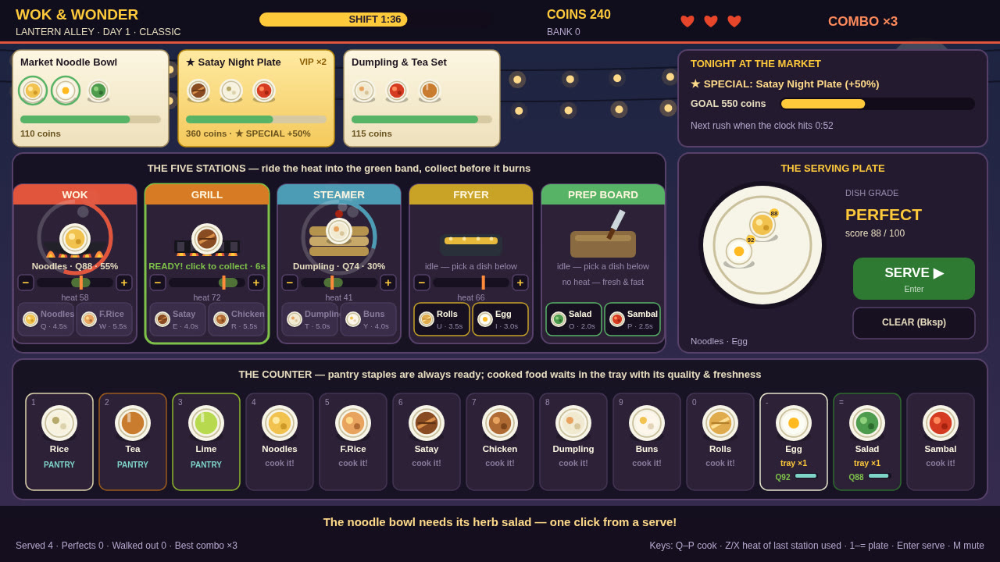

# Wok & Wonder: Night Market Rush

An original night-market cooking game for the make.fun bounty
**best-cooking-game-20261125-0137**, built by **@badd-airdrop2**.

## The game

You run a stall in a lantern-lit night market. Orders land on the ticket
rail; you cook their components at **five stations** — wok, grill, steamer,
fryer and prep board — plate them, and serve before patience runs out.

What makes it more than a clicker:

- **Real-time heat management.** Every hot station holds a heat you set with
  −/+ (or Z/X). Each dish has an ideal heat band, painted green on the
  gauge: cook inside it and quality climbs toward PERFECT; run too hot and
  quality burns away while the food cooks faster; too cold and it crawls.
- **Overcooking.** Finished food waits on the hot station for a few seconds,
  losing quality, then it *burns* and blocks the station until cleared.
- **Quality & freshness.** Cooked food carries a quality score into the
  tray, then slowly loses freshness. A served dish is graded on its weakest
  component, its average quality and its freshness — PERFECT (85+) pays a
  60% bigger tip.
- **A living market.** VIP orders pay double but wait less; a daily special
  pays +50%; two **rush hours** a day surge the crowd (prices +20%, patience
  drains faster); combos multiply earnings; walkouts cost hearts.
- **Progression.** Three markets (Lantern Alley → Riverside Promenade → Sky
  Lantern Rooftop) with 6/9/12 recipes, three difficulties, an **Endless
  Night** mode, and a permanent **ten-upgrade shop** (Turbo Burner, Wide
  Flame, Extra Ticket Rail, Lucky Cat…) bought with banked earnings and
  saved between visits.

## Controls

- **Mouse / touch:** cook buttons, heat −/+, click a station to collect,
  counter tiles to plate, click a glowing ticket or SERVE to serve.
- **Keyboard:** `Q/W E/R T/Y U/I O/P` cook · `Z/X` heat · `1–=` plate ·
  `Enter` serve · `Backspace` remove last · `M` mute.

## Tech

Static vanilla JS + Canvas 2D, no libraries, no network, synthesized
WebAudio sound. Source is split one job per file under `game/src/`
(config / random / audio / world / render / input / shots / main).
`main.ts` (Node 22) packages `game/` + `screenshots/` and writes the
competition dossier via `vendor/makefun-game.ts`.

## Screenshots

1. `1-rush.jpg` — a rush in full swing: three tickets (one VIP, one daily
   special), the wok mid-cook inside its heat band, satay ready to collect,
   a plate one ingredient from a PERFECT serve.
2. `2-title.jpg` — title: three markets, three difficulties, endless mode.
3. `3-shop.jpg` — the ten-upgrade shop with a working bank.
4. `4-dayend.jpg` — a three-star day end and a newly unlocked market.

MIT licensed — see `LICENSE`.
